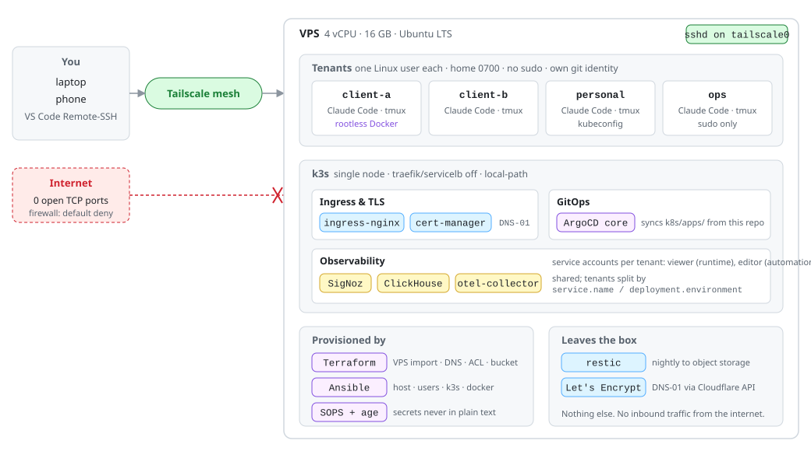

# one-vps-platform

**One cheap VPS, turned into a private engineering platform for several clients, with nothing exposed to the internet.**

Tailscale-only access, one Linux user per client, k3s + ArgoCD, shared observability, rootless Docker where a tenant needs it. All of it is Terraform + Ansible + GitOps; a fresh box becomes a working platform in about 30 minutes.

English · [Português](README.pt-BR.md)

    

## Result

| Before (one Windows PC) | After (16 GB VPS + the PC as a thin client) |
|---|---|
| 79 % RAM used before opening a single lab | PC at 60 % **with a AAA game running**; the work session still alive on the server |
| Three GitHub identities behind one `gh` login | One Linux user per client, `0700` homes, own git identity, a wrong-company commit is impossible |
| Nothing reachable away from the desk | Laptop, phone, anywhere on the tailnet; the internet sees **zero** open TCP ports |
| Setup lived in `%AppData%` | `scripts/rebuild.sh` → fresh OS to full platform in ~30 min |
| | 19 % RAM idle with the full stack; **44 %** under a 14-service OpenTelemetry load test |
| | 1 incident (ZooKeeper OOM under load), 35 min, root cause + fix in [the postmortem](docs/decisions/0004-incident-signoz-zookeeper-oom.md) |

<picture>
  <source media="(prefers-color-scheme: dark)" srcset="docs/assets/architecture-dark.svg">
  
</picture>

## What it solves

| Problem | How |
|---|---|
| Client work, personal projects and games fighting over one machine | Work moves to the VPS; the PC only draws pixels (VS Code Remote-SSH) |
| Credentials of unrelated clients side by side | One Linux user per tenant, no sudo, own `gh`/git identity, home nobody else can read |
| A dev server that is also a public attack surface | It isn't public. Tailscale mesh; SSH, API server and ingress bind to the tailnet interface only |
| Valid TLS for hosts the internet can't reach | cert-manager with Let's Encrypt **DNS-01**: the challenge is a DNS record, not an open port |
| One tenant needs `docker compose`; the box runs k3s | **Rootless** Docker scoped to that user; root daemon masked; no conflict with containerd |
| One observability stack, several tenants | SigNoz shared; data tagged `service.name` / `deployment.environment`; per-tenant service accounts (viewer for runtime, editor for automation) |
| "It works on my server" | Everything is a commit: Terraform (VPS, DNS, Tailscale ACL, bucket), Ansible (host, users, k3s, docker, backup), ArgoCD (`k8s/apps/`), SOPS for secrets |

## How it works

```
terraform/      hostinger (import only, destroy would cancel the plan) · cloudflare · tailscale · oci
ansible/        base → tailscale → users → k3s → docker-rootless → backup      (site.yml runs all)
k8s/            bootstrap/argocd (core + app-of-apps) · apps/ (ingress-nginx, cert-manager, signoz)
scripts/        bootstrap-argocd.sh · rebuild.sh
docs/           CONFIGURE.md · ARCHITECTURE.md · decisions/ (ADRs + postmortem) · inventory.md · client/ssh_config.example
```

Bootstrap in one line: provider gives a fresh Ubuntu → `terraform apply` → `ansible-playbook site.yml` → Tailscale up → **close port 22 at the provider** → `scripts/bootstrap-argocd.sh` → apps sync from Git. Full runbook, memory budget and SigNoz quirks: [docs/ARCHITECTURE.md](docs/ARCHITECTURE.md).

## Decisions

Short ADRs, one per choice that someone might question:

- [0001, a rented VPS instead of a home server](docs/decisions/0001-vps-instead-of-homelab.md)
- [0002, k3s single-node + ArgoCD core](docs/decisions/0002-k3s-and-argocd-core.md)
- [0003, one Linux user per tenant](docs/decisions/0003-one-linux-user-per-tenant.md)
- [0004, incident: SigNoz stopped ingesting (ZooKeeper OOMKilled)](docs/decisions/0004-incident-signoz-zookeeper-oom.md)

## Use it

Clone, then follow [docs/CONFIGURE.md](docs/CONFIGURE.md): copy the `*.example` files, replace every `YOUR_*` placeholder (`scripts/check-placeholders.sh` lists what is left), generate an `age` key for SOPS, and run the runbook. It assumes a Hostinger KVM VPS, Cloudflare DNS and a Tailscale account, but every provider-specific piece is a thin Terraform module you can swap.

## License

MIT.
